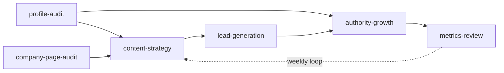

# LinkedIn Growth Skills

[](https://github.com/9heaven/linkedin-growth-skills/actions/workflows/check.yml)


Six agent skills that turn a LinkedIn presence into a pipeline for **founders,
consultants, creators, and agency owners**. They audit, rewrite, plan, and measure,
and they judge all of it by one number: qualified conversations.

**Not for job seekers.** No ATS scoring, no recruiter keywords, no "open to work"
framing. The profile is treated as a conversion asset, not a resume.

Works with Claude Code, Claude.ai, Codex, Cursor, OpenClaw, Hermes, and any agent
that reads [Agent Skills](https://agentskills.io/specification).

## Quick start

1. Install all six skills:

   ```bash
   npx skills add 9heaven/linkedin-growth-skills
   ```

   In Claude Code you can install them as a plugin instead (see [Install](#install)).

2. Ask your agent:

   > Audit my LinkedIn profile. I want to attract heads of operations at logistics
   > companies and get them to book a call.

3. Paste what it asks for (headline, About, Featured, a few numbers from Analytics).
   You get a weighted score, the single biggest leak, three headline options, a full
   About rewrite, and a five-item list for this week.

No login, no browser extension, no LinkedIn password. Pasting always works.

## Which skill do I need?

| Your situation | Say something like | Skill |
|---|---|---|
| The profile has not been touched in a while | "Audit my LinkedIn profile" | **linkedin-profile-audit** |
| You only want one piece rewritten | "Just rewrite my headline" | **linkedin-profile-audit** (quick mode) |
| The profile is fine but nothing happens | "What should I post on LinkedIn?" | **linkedin-content-strategy** |
| Posts get views but nobody messages you | "Why am I not getting leads?" | **linkedin-lead-generation** |
| Someone replied and you don't know what to say | "How do I reply to this DM?" | **linkedin-lead-generation** (quick mode) |
| You run a company page that nobody sees | "Audit our company page" | **linkedin-company-page-audit** |
| You want to be known for one thing | "Help me narrow my niche" | **linkedin-authority-growth** |
| You have analytics and want a verdict | "Is LinkedIn working for me?" | **linkedin-metrics-review** |

Every skill has a **quick mode**. Ask for one piece and it does that piece, instead
of running the full audit.

## What an audit looks like

An abbreviated profile audit, using the worked example from the
[scoring rubric](skills/linkedin-profile-audit/references/scoring-rubric.md):

```
Profile type: Founder · Audience: clients · Market: national · Size: under 10K
N/A (not provided): Services

| Section  | Weight | Score | Biggest leak                      | Fix                            |
|----------|--------|-------|-----------------------------------|--------------------------------|
| Activity | 5      | 1     | No original post in 8 months      | 3 posts a week (content skill) |
| Featured | 4      | 0     | No next step for visitors         | Booking link in slot 1         |
| Headline | 5      | 2     | Job title, no audience or outcome | 3 options below                |
| ...      |        |       |                                   |                                |

Weighted score: 37 / 100 (under 40: full rewrite)
Losing the most points: Activity (20), Featured (20), Headline (15)

Your biggest leak is publishing: visitors find no recent posts, so nothing gives
them a reason to follow or book.
```

Missing data is marked N/A instead of scored 0, and any number the skill cannot
verify becomes a `[your number]` placeholder.

## Install

### Any agent, with the skills CLI

```bash
npx skills add 9heaven/linkedin-growth-skills
```

<details>
<summary>One skill, one agent, or every project</summary>

One skill:

```bash
npx skills add 9heaven/linkedin-growth-skills --skill linkedin-profile-audit
```

For one agent only, add `-a` (for example `-a claude-code`). To make the skills
available across all projects, add `-g`. Update later with:

```bash
npx skills update
```

</details>

### Claude Code, as a plugin

Inside a session:

```
/plugin marketplace add 9heaven/linkedin-growth-skills
/plugin install linkedin-growth-skills@9heaven
```

<details>
<summary>From the shell, and how to update</summary>

```bash
claude plugin marketplace add 9heaven/linkedin-growth-skills
```

```bash
claude plugin install linkedin-growth-skills@9heaven
```

To update, refresh the marketplace, then update the plugin:

```bash
claude plugin marketplace update 9heaven
```

```bash
claude plugin update linkedin-growth-skills@9heaven
```

Plugin skills are namespaced, for example `/linkedin-growth-skills:linkedin-profile-audit`.
Claude also picks them up on its own when a request matches.

</details>

<details>
<summary>Claude Code, by hand</summary>

Claude Code looks for `~/.claude/skills/<skill-name>/SKILL.md`, so clone the repo
somewhere else and link each skill folder in:

```bash
git clone https://github.com/9heaven/linkedin-growth-skills.git ~/linkedin-growth-skills
```

```bash
mkdir -p ~/.claude/skills && ln -s ~/linkedin-growth-skills/skills/* ~/.claude/skills/
```

Run `git pull` in `~/linkedin-growth-skills` to update.

</details>

<details>
<summary>Claude.ai</summary>

Zip a skill folder (for example `skills/linkedin-profile-audit/`, with its
`references/` inside) and upload it as a custom skill. Code execution must be on.
Anthropic's [Use skills](https://support.claude.com/en/articles/12512180-use-skills)
article shows where the upload button is on your plan.

Upload the whole folder. Pasting only `SKILL.md` into a Project drops the reference
files the skill reads.

</details>

## The skills

| Skill | What you get |
|---|---|
| **linkedin-profile-audit** | A weighted score across 10 sections (adjusted for founders, consultants, creators, and operators with a side offer), the biggest leak, 3 headlines, a full About, Featured, current role, and banner brief. |
| **linkedin-company-page-audit** | A 12-element page score, where page traffic really comes from, rewritten tagline, About, specialties, button and Products entries, and a founder-to-page content loop. |
| **linkedin-content-strategy** | 3–4 pillars with topic seeds, a cadence that fits your time, a 4-week calendar with drafted hooks, and 3 posts ready to publish. |
| **linkedin-lead-generation** | The broken step in content-to-client, a one-line offer, inbound plays, DM scripts, and capped warm outreach. |
| **linkedin-authority-growth** | A narrowed position, a proof-stack audit, a comment and collaboration routine, a signature format, and a dated 90-day arc. |
| **linkedin-metrics-review** | A 5-tier read from revenue down to impressions, engagement rates computed properly, and one change for next week. |

## How they fit together



Start with `linkedin-profile-audit`. If the profile scores well but nothing happens,
the bottleneck is content, not copy: go to `linkedin-content-strategy`. Each skill
ends by pointing to the next one.

## What makes these different

- **Zero fabrication.** The skills never invent clients, numbers, credentials, or
  people. Gaps become placeholders, and missing data is N/A, not 0.
- **Conversations over vanity metrics.** Followers are a leading indicator at best.
  Every skill reports qualified conversations first.
- **Sourced numbers.** Every platform figure in
  [`platform-reality.md`](shared/references/platform-reality.md) has a source link
  and a grade: LinkedIn, Study, Reported, or House rule. The skills know which
  numbers are LinkedIn's own and which are practitioner lore.
- **No spam, no automation, no scraping.** Outreach is capped at human volume and
  personalized. The skills refuse mass-DM and bulk-scraping requests.
- **Your voice, not a brand deck.** A banned-phrase list, no em dashes, and a rule
  to keep your own phrasing, so the drafts actually get published.
- **Tested.** CI validates every skill on each push, and
  [eval cases](evals/) cover the main jobs and the refusals.

## Data and privacy

The skills ask you to paste your own profile text and analytics. The optional
browser read fetches public, logged-out pages one at a time. Nothing is stored,
sent anywhere, or collected in bulk, and no LinkedIn credentials are ever requested.

## FAQ

**Do I need to give it my LinkedIn login?** No. You paste text, or the agent reads
your public profile logged out. It never asks for credentials, cookies, or a session.

**Can this get my account restricted?** The skills refuse automation. Manual
outreach is capped at 10–15 personalized invitations a weekday, with 20 as a hard
ceiling, and dormant accounts get a warm-up plan first.

**How current are the platform numbers?** Last verified in November 2026, each with
its source and grade. The file says how to cite each kind, and it is re-checked
quarterly.

**Will it make up results to make my profile look better?** No. If a sentence needs
a number you did not give, you get a `[your number]` placeholder.

**Can an agency run it for clients?** Yes. Paste the client's profile, or read their
public page with their permission. The rules allow one page at a time, never bulk
collection.

**Why not for job seekers?** Recruiter search and buyer conversion are different
jobs. The related skills below serve job seekers well.

## Related work

These skills were built after reviewing the LinkedIn skills already published on
skills.sh. Several are good and solve adjacent problems:

| Skill | What it does better | Why ours is separate |
|---|---|---|
| [paramchoudhary/resumeskills: linkedin-profile-optimizer](https://github.com/paramchoudhary/resumeskills/tree/main/skills/linkedin-profile-optimizer) | Job-seeker profile optimization, recruiter search | We deliberately exclude job seekers |
| [social-media-skills/skills: linkedin-company-pages](https://github.com/social-media-skills/skills/tree/main/skills/linkedin-company-pages) | Deep employee-advocacy program design, publishing-tool integration | Ours is small-business sized, no tool dependency |
| [schwepps/skills: linkedin-personal-branding](https://github.com/schwepps/skills/tree/main/linkedin-personal-branding) | Industry benchmark tables, SSI reporting, Chrome extension capture | Ours is conversion-first and paste-first |
| [brianrwagner: linkedin-authority-builder](https://github.com/brianrwagner/ai-marketing-claude-code-skills) | Quick, standard, and deep mode selection | Ours ties authority to a proof stack and a 90-day arc |
| [cold-iq/coldiq-s-gtm-skills: linkedin-limits-warmup](https://github.com/cold-iq/coldiq-s-gtm-skills/tree/main/skills/linkedin-limits-warmup) | Account limits and warm-up detail | We absorbed the limits; we do not sell a data vendor |

## Contributing

Issues and PRs are welcome. Keep new work consistent with the principles above: no
fabrication, no automation for spam, decisive scoring, and concrete deliverables
instead of general advice. [CONTRIBUTING.md](CONTRIBUTING.md) covers the repo
layout, the checks, evals, and how to cut a release. Release notes are in
[CHANGELOG.md](CHANGELOG.md).

## License

MIT. See [LICENSE](LICENSE).
